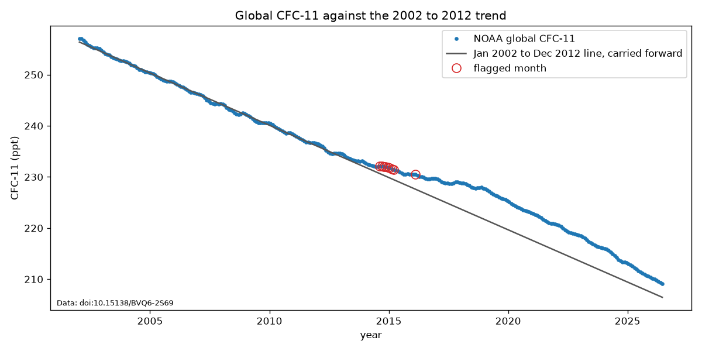

# C02. Banned CFC-11 traced to eastern China

**What happened.** CFC-11, an ozone-destroying gas once used in foam insulation, was phased out under the Montreal Protocol, so its emissions should have kept falling. In 2018 scientists reported they had risen since 2012 (Montzka et al., Nature). In 2019, measurements from stations in South Korea and Japan traced much of the rise to eastern China (Rigby et al., Nature). China cracked down, and emissions fell.

**What it shows.** The gap between "banned, so falling" and the measured air was the signal (L3). A treaty meant someone was responsible for acting on it (R9).

## Checked against the data

The rule was set before anyone saw a reading ([issue 16](https://github.com/Ciaran11221/Shadow-Associative-Prediction-Theory/issues/16)): draw a straight line through the previous 10 years, extend it one month, and flag the month if the reading sits more than 3 times the usual miss above the line. Usual miss is how far those 10 years normally sit from their own line. Data: NOAA's combined table, version 2026-06-11. Code: [scripts/c02_cfc11.py](../scripts/c02_cfc11.py). Output: [cases/C02](C02/). To rebuild every number yourself, follow [the steps](C02/README.md).

| Question | Result |
|---|---|
| Did the fall slow after 2012? | Yes. 2.045 ppt a year in 2002–2012, then 1.122 ppt a year in 2013–2017, which is 54.9% of the earlier speed. The rule asked for 40% to 60% |
| How early would the check flag the global average? | August 2014, 45 months before the paper, with no false alarms in the 96 months tested before 2013 |

**The margin is thin.** The global result holds only for cut-offs between 2.19 and 3.76 times the usual miss. At 2 times there are 7 false alarms, the first in December 2009. At 4 times nothing flags. The cut-off was set before the data was opened, so the result is fair, but a strong signal wouldn't sit in so narrow a gap.

## Worth a look

Worth a look is the earliest month a check fixed in advance would have put a case in front of a person. It's a marker, not proof.

**November 2013, 54 months before the paper.** The same rule, unchanged, was run once on all 16 series in the table ([all_series.csv](C02/all_series.csv)). Worth a look is the earliest flag from 2013 on a series with no false alarm before it.

| Measurement | North average | Cape Kumukahi, Hawaii |
|---|---|---|
| Reading | 234.403 ppt | 234.329 ppt |
| Where the 10-year line said it should be | 233.389 ppt | 233.254 ppt |
| Gap | +1.014 ppt | +1.075 ppt |
| Cut-off (3 × usual miss) | 0.996 ppt | 1.034 ppt |
| Times the usual miss | 3.06 | 3.12 |

**The cross-check is the order of arrival.** A gas released in the north should show in the north first, then spread south, and it does:

| First flag from 2013 | Where |
|---|---|
| November 2013 | North average, Cape Kumukahi, Niwot Ridge (Colorado) |
| April 2014 | The gap between north and south |
| May 2014 | Trinidad Head (California) |
| August 2014 | Global average, Mauna Loa |
| October to December 2014 | Summit, Pt. Barrow, Alert, Mace Head, Cape Matatula, South Pole, south average |
| January 2016 | Palmer Station (Antarctica) |
| October 2017 | Cape Grim (Tasmania) |

The yearly gap between north and south was 1.83 ppt in 2012, 2.94 in 2014 and 3.11 in 2017, then 1.15 in 2021. It widens with the release and closes after it stops.

**Limits.**

- The series was picked after seeing the data. The rule is unchanged, but 16 tries make an early hit more likely by luck, which is why the order of arrival counts for more than any single date.
- The November 2013 flag is one month, by 0.018 ppt. The north doesn't flag again until September 2014. Niwot Ridge has one false alarm before 2013 and Mauna Loa has five.
- All 16 series come from one lab, so under R2 they count as one source.
- The table is smoothed, so a month's value can borrow from later months and any flag date is approximate. It's on a 2016 calibration scale, so it isn't exactly what anyone saw in 2014.
- A flag says the fall slowed, not why or who. It took measurements in South Korea and Japan to trace it.
- Whether anyone would have acted on a flag isn't measured (R9). Production in eastern China appears to have fallen during 2017–2018 (Park et al. 2021), so the fall can't simply be credited to the May 2018 paper.

**What could move it earlier.** Gases made alongside CFC-11, which rose after 2013 and fell one to two years before it (Park et al. 2021), and NASA's AIRS infrared satellite, whose trends are less negative over Shandong but also over two regions with no known source (Chen et al. 2020). Any earlier date has to come from a check fixed before its data is opened, and tested on gases with no scandal.

## Cross-check: AGAGE

AGAGE is a separate network with its own labs and instruments, so it's the independent angle (L2). The rule was fixed on [issue 18](https://github.com/Ciaran11221/Shadow-Associative-Prediction-Theory/issues/18) before its readings were opened: the same 10-year rule on five long records, and a 5-year line at Gosan, on how far its readings sit above clean air that month, because its record starts in 2007. The pass mark was at least 3 of the 5 long records flagging before May 2018, with no false alarms before 2013.

**First run: no, 2 of 5.** One missing month blocked the next 10 years, so four stations weren't tested in the period that matters. That result stays on record ([agage.csv](C02/agage.csv)).

**Gap rule: yes, 5 of 5.** A new rule was posted on issue 18 before those stations were looked at: a month is tested if at least 90% of its window has readings, the line is fitted through the months that exist, and nothing is filled in ([agage_gaps.csv](C02/agage_gaps.csv)).

| Station | First flag from 2013 | Months before the paper | Times the usual miss | False alarms before 2013 |
|---|---|---|---|---|
| Gosan, South Korea | May 2013 | 60 | 6.13 | No history |
| Trinidad Head, California | November 2013 | 54 | 3.09 | 0 |
| Ragged Point, Barbados | December 2013 | 53 | 3.38 | 0 |
| Mace Head, Ireland | November 2014 | 42 | 3.17 | 0 |
| Cape Matatula, Samoa | December 2016 | 17 | 3.04 | 0 |
| Cape Grim, Tasmania | August 2017 | 9 | 3.03 | 0 |

A separate lab flags in the same month as worth a look, and the station nearest the source flags first.

**Limits.**

- The pass came after a rule change that followed a no, and two of the five stations had already been seen when the change was written.
- The pass mark was loose: two of the five flags came only 17 and 9 months before the paper.
- Gosan's May 2013 is the strongest flag here, but it can't move worth a look yet. Only 45 of its 86 months were tested, and it has no false-alarm history. It needs the same measure run on gases with no scandal.
- Trinidad Head's flag is a narrow one: a gap of 1.38 ppt against a cut-off of 1.339.

## The flag count

One flag is weak. Counting them isn't. [Issue 21](https://github.com/Ciaran11221/Shadow-Associative-Prediction-Theory/issues/21) set a ladder: for any month, how many sources flagged in that month or the 11 before it. A source is one lab's record at one station. The levels stack, so one lab alone stops at level 2 ([issue 23](https://github.com/Ciaran11221/Shadow-Associative-Prediction-Theory/issues/23)).

| Level | Needs | Action |
|---|---|---|
| 1 | 1 source | Log it |
| 2 | 2 or more sources | Worth a look |
| 3 | 3 or more sources from both labs | Escalate |
| 4 | 10 or more sources from both labs, in both hemispheres | Act |

On CFC-11's 18 sources (12 NOAA stations, 5 long AGAGE records and Gosan), the 96 months before 2013 read 62 at level 0, 31 at level 1 and 3 at level 2, with none higher. Level 3 arrives in November 2013, and level 4 in December 2014 with 14 sources. The levels were picked after seeing this, so CFC-11 can't prove them. Code: [scripts/flag_ladder.py](../scripts/flag_ladder.py).

## False flags

A sign only means something if the check stays quiet when nothing is happening. Issue 23 picked 4 banned gases with no reported change before anyone opened their readings, and set the pass mark: none may reach level 3. Code: [scripts/clean_gases.py](../scripts/clean_gases.py). Output: the `clean_` files in [cases/C02](C02/).

**Result: fails. 2 of 4 reached level 3.** That stays on record.

| Gas | Sources tested | Source-months | Flags | Chance alone gives | Top level | Gas-years |
|---|---|---|---|---|---|---|
| Methyl chloroform | 22 | 3,927 | 0 | 7.1 | 0 | 20.5 |
| H-1301 | 22 | 2,076 | 3 | 3.8 | 1 | 12.3 |
| H-1211 | 24 | 4,312 | 11 | 7.8 | 3 | 21.1 |
| H-2402 | 22 | 2,045 | 40 | 3.7 | 4 | 7.9 |

"Chance alone" is 0.182% of tested months, the rate for a straight fall. A gas-year is one gas watched for a year, counting only months where level 3 was possible. That makes 3 level 3 runs in 61.8 gas-years. On the 18 sources CFC-11 had, 1 of 4 reached level 3: H-2402.

Worth a look stays at November 2013. Issue 23 said Gosan could move it to May 2013 only if its measure flagged on none of the 4, and it flagged on 3.

**H-2402 shouldn't have been on the list.** A paper from April 2026 reports its emissions rising since 2015, driven by East Asia (Choi et al.), and an abstract from the same group in April 2024 is the earliest public report found. The test on issue 23 would have put it out. The search leaned on the 2022 WMO assessment and missed it, and the paper turned up only after the run.

In the run, H-2402's fall about halved in both labs between 2010–2015 and 2022–2025: NOAA from 0.0066 to 0.0033 ppt a year, AGAGE from 0.0071 to 0.0039. The ladder reached level 3 in May 2021 and level 4 in September 2022, 35 and 19 months before that abstract. This is an observation, not a result. Nobody set the run up as a test of H-2402, the paper was found after the flags, and April 2024 is the first public date found, not the date anyone first noticed.

**H-1211 is the false alarm.** Its fall is steady and its flags are close to chance. Level 3 came from local things lining up: one-month spikes in NOAA's Wisconsin flasks, a one-month jump at Jungfraujoch that shows on all three halons in May 2021, and a hump at Ragged Point. On CFC-11's 18 sources it never reaches level 3.

**Why the ladder failed.** A count of 3 is too low for 22 to 24 sources over 20 years. On a straight fall with nothing happening, chance alone takes a gas to level 3 6% to 18% of the time, so about 41% of the time at least one of the 4 gets there. That sum should have been done before the pass mark was set. The count stays as it is for now, because 5 gases can't set a new one.

**Limits.**

- A flag says a fall slowed, not why. A bend in a gas's global curve reaches every station in the same years, so two labs can agree on what happened without showing the cause.
- The halons have no combined table, so they use plain monthly averages of flask samples, which aren't smoothed the way CFC-11's table is.
- Only the abstracts of Choi et al. were read.
- Searches after the run found no reported change for H-1211, H-1301 or methyl chloroform. That isn't proof there was none.
- These 4 gases have now been seen, so they can't judge a new version of the ladder.

## Gas events

A check also has to fire when something real happens. [Issue 25](https://github.com/Ciaran11221/Shadow-Associative-Prediction-Theory/issues/25) listed every gas with a published change that both labs could test, and dated the list and the scoring before any of their readings were opened. A [comment on 6 November](https://github.com/Ciaran11221/Shadow-Associative-Prediction-Theory/issues/25#issuecomment-6690511615), also before the run, tightened what counts as a hit. Code: [scripts/gas_events.py](../scripts/gas_events.py). Output: the `events` files in [cases/C02](C02/).

- **Event stretch:** from the month the change began up to the month before the first public date. A hit is the level going from under 3 to 3 or more inside it. A level 3 carried over from before the change doesn't count.
- **Quiet stretch:** from January 2005 up to the month the change began. Level 3 there is a false alarm.
- **Not testable:** fewer than 3 sources, or only one lab, tested in the event stretch.

**Result: 1 hit, 2 misses, 1 not testable, and 1 false alarm in 3 quiet stretches.** That stays on record.

| Gas | Change began | First public date, as dated | Result | First level 3 | Lead | False alarm |
|---|---|---|---|---|---|---|
| Carbon tetrachloride | 2013 | 10 Feb 2021, Park et al. | Hit | Jan 2015 | 73 months | No |
| CFC-12 | 2013 | 10 Feb 2021, Park et al. | Miss | None | None | No |
| HCFC-141b | 2017 | 27 Apr 2022, Western et al. | Miss | None | None | Nov 2011 |
| CFC-115 | 2011 | 10 Oct 2017, Vollmer et al. | Not testable | None | None | None |

CFC-12 and carbon tetrachloride are tied to CFC-11, so the three of them count as one event. Before the run, the code met copies of the real files with every reading replaced by a made-up one, and each planted result read right. After it, a separate program that shares no code agreed on all 12,596 source-months and every outcome.

**How much luck can do.** Before the run, a sum using each source's tested months, and no readings, gave each gas's chance of a hit and of a false alarm from luck alone. Each gas reads against the row nearest its own flag rate in its quiet stretch, a reading set before the run.

| Month flag rate | HCFC-141b | CFC-12 | Carbon tetrachloride |
|---|---|---|---|
| 0.182%, a straight fall | 5.7% / 5.0% | 7.9% / 3.9% | 7.6% / 3.9% |
| 0.305%, noise that carries over | 18.9% / 18.0% | 26.2% / 14.4% | 25.3% / 14.4% |
| 0.472%, CFC-11's own rate before 2013 | 44.2% / 42.2% | 56.0% / 35.9% | 53.9% / 35.9% |

Each cell is a lucky hit, then a lucky false alarm. A level of 3 is a low bar, which is why a single hit proves little.

**Carbon tetrachloride is the hit.** Level 3 came in January 2015 from three sources: NOAA Mauna Loa in March 2014, AGAGE Mace Head from August to October 2014, and AGAGE Samoa in January 2015. Two of those only just cleared the line, at 3.19 and 3.06 times the usual miss, and none of the three flagged on another gas within a month. Its quiet stretch flagged 3 times in 1,324 source-months, 0.227%, which picks the 0.182% row: a lucky hit 7.6% of the time, or 12.8% at its exact rate. The stronger sign is the stretch as a whole. Gosan aside, 68% of readings sat above the line, against 30% in the quiet years, flags came 9 times as often, and a second run at level 3 lasted from December 2017 to October 2019.

**An earlier report turned up after the run.** Lunt et al., online 18 October 2018, reported a new source of carbon tetrachloride in China's Shandong province after 2012. Measured from it, the lead is 45 months, not 73. The scored result stays as dated and this sits beside it, as with H-2402. Park et al. 2018, a discussion paper from March 2018, reported large unreported emissions from China for 2011 to 2015 but not a change, so it isn't counted.

**CFC-12 is a clean miss.** Apart from one Gosan flag in May 2013, its readings sat below the line the whole time: the highest in the event stretch was 1.52 times the usual miss. The extra emissions made its fall a little shallower without ever turning it upward. The rule only sees readings above the line, so a fall that only slows can't flag. That blind spot is now on record.

**HCFC-141b missed, and its false alarm was a real rise.** Gosan aside, only 3% of its readings sat above the line in its event stretch, as issue 25 expected for a gas that was still bending over. The false alarm came in November 2011 from 8 northern sources in both labs within two months, with southern stations following 3 to 22 months later, which is how a change in the air spreads. The 2014 ozone assessment, public on 10 September 2014, reported HCFC-141b emissions rising since the previous assessment, in line with reported production, which peaked again in 2011. So the alert saw a real rise, a legal and reported one, 34 months before that assessment said so. Under the dated rules it stays a false alarm.

**CFC-115 couldn't be tested,** as expected: NOAA's file runs only from January 2010 to August 2015, too short for the 10-year rule. AGAGE stations flagged it 9 times in 2017 before the October paper, but one lab alone stops at level 2.

**Seen in passing, not scored.**

- Gosan flagged CFC-11, CFC-12, carbon tetrachloride and CFC-115 in May 2013, and none of its other four gases that spring. A plume from eastern China fits, and so does a shift in the winds.
- Carbon tetrachloride reached level 3 again from June 2024 to May 2026, and was back at level 2 in June 2026, the latest month. The newest data are often revised.

**Limits.**

- Stations measure at fixed points, so a flag can come from a change in how air is carried to them as well as from emissions. A hit shows timing, not cause.
- The lead runs to the first public report found, not to when anyone first noticed.
- Only the abstracts of Park et al. 2021 and Lunt et al. 2018 were read, and only the summary of the 2014 assessment.
- Quiet stretches keep turning out not to be quiet: H-2402 last time, HCFC-141b now. That makes false alarms look more common than they are.
- These four gases have now been seen, so they can't judge a new version of the ladder.

## Bursts

A false alarm is a flag when nothing known is happening. A run of them far above a gas's usual rate might still mark something real: a change in the air, a fault in an instrument, or a source next to one station. [Issue 28](https://github.com/Ciaran11221/Shadow-Associative-Prediction-Theory/issues/28) set the rules for the 16 gases both labs publish that hadn't been run, before any of their readings were opened. Two comments tightened them before the files were downloaded ([fixes](https://github.com/Ciaran11221/Shadow-Associative-Prediction-Theory/issues/28#issuecomment-6713603483), [wording](https://github.com/Ciaran11221/Shadow-Associative-Prediction-Theory/issues/28#issuecomment-6713893752)), and a [third](https://github.com/Ciaran11221/Shadow-Associative-Prediction-Theory/issues/28#issuecomment-6730478369), posted before the run, said how the result would be read. Code: [scripts/flag_bursts.py](../scripts/flag_bursts.py). Output: the `bursts` files in [cases/C02](C02/).

- **Burst:** a gas in a calendar year with far more flags than its usual rate in earlier years gives, so many that luck gives that count less than 1 time in 20 divided by the gas years judged. With 271 judged, that's about 1 in 5,400.
- **Question 1:** do bursts land in years touching a known change (a rise from the papers, or an instrument change in NOAA's notes) more often than in other years? It's judged inside each gas, so which gas it is can't fake the answer.
- **Question 2:** do bursts seen at 3 or more stations in both labs (air) sit in rising years more often than bursts at one station?
- **Down check:** years that only touch a known fall shouldn't burst more than years with no known change.

**Result: Question 1 fails.** 17 bursts. Bursts per year were 2.4 times as common in years with a known change (9 in 98) as in other years (5 in 131), but with each gas's bursts shuffled among its own years, luck gives that 32 times in 100, and a pass needed under 5. Question 2 couldn't be judged: 3 one-station bursts, and it needs 5. With 12 air and one-station bursts, under the 40 the third comment named, that reads as too few to tell. The down check is fine: no bursts in 11 years with only a known fall, against 8 in 162 years with no known change. Issue 28 said that if bursts don't land in known changes more than elsewhere, the idea goes. It goes, and the result stays on record.

| Gas | Year | Kind | Flags, against expected | Known change in that year |
|---|---|---|---|---|
| HCFC-22 | 2007 | air | 27, against 3.3 | Rise: Montzka 2009, Saikawa 2012 |
| HCFC-22 | 2008 | air | 35, against 15.3 | Rise: Montzka 2009, Saikawa 2012; NOAA instrument note |
| HCFC-142b | 2008 | one station, many gases | 6, against 0.3 | Rise: Montzka 2009; NOAA instrument note |
| HFC-134a | 2010 | air | 19, against 1.1 | None |
| HFC-134a | 2011 | unsorted | 20, against 5.5 | None |
| HFC-134a | 2016 | air | 31, against 9.4 | Rise: Choi 2024 |
| HFC-134a | 2017 | air | 39, against 11.5 | Rise: Choi 2024 |
| HFC-32 | 2017 | unsorted | 15, against 0.3 | Rise: Choi 2024 |
| HFC-227ea | 2016 | one station, many gases | 8, against 1.5 | None |
| SF6 | 2007 | unsorted | 30, against 0.2 | Rise: Rigby 2010 |
| SF6 | 2008 | unsorted | 37, against 11.4 | Rise: Rigby 2010, Simmonds 2020 |
| SF6 | 2022 | air | 50, against 11.5 | NOAA replaced its SF6 flask system |
| SF6 | 2023 | air | 29, against 13.3 | None |
| SF6 | 2025 | air | 37, against 12.2 | None |
| Nitrous oxide | 2014 | unsorted | 10, against 1.4 | None |
| Nitrous oxide | 2022 | one station, one gas | 11, against 1.7 | None |
| Methyl bromide | 2016 | air | 19, against 1.2 | None |

Before the run, the code met copies of the real files with every reading replaced by a made-up one, and every planted burst read right. After it, a separate program that shares no code agreed on all 51,026 tested source-months, every burst and all three answers.

**How much noise can do.** Before the run, a chance sum laid made-up flags on the real tested months. Flags that come one at a time give about 0.011 bursts a run at 0.182% a month, but the same rate in streaks of 3 months at one station gives about 1.5. So the third comment promised to measure the real noise after the run. Outside the 17 burst years the real flags were 632 in 48,163 tested source-months, mostly single months. Copied into 1,000 made-up runs with nothing real in them, that noise gave 2.3 bursts a run, and none of the 1,000 reached 17. About 2 of the 17 could be noise.

**What the bursts look like.** All 17 build up and stay. At the middle station of each burst, readings sat above the line in 83 to 100% of the 6 months before its first flag and in all 12 after, and most stations flagged again within a year. A one-off spike, like Jungfraujoch's halons in May 2021, looks different: nothing builds before it and nothing repeats. Where both labs measure the same air they mostly move together, so the bursts aren't one lab's fault. HCFC-22 at Cape Grim in 2008 flagged 6 months in each lab, and SF6 in 2022, the year NOAA's new flask system came in, flagged 7 months at AGAGE's Cape Grim and Mace Head against 2 and 0 at NOAA's.

**The 2007 to 2008 group.** HCFC-22 and SF6 flagged at the same NOAA stations in the same months, mostly in the south. Each gas rose on its own: the other lab agrees on HCFC-22 at Cape Grim, every station built up for months first, and the north rose as much as the south or more. The south flagged more because its readings are steadier. Cape Grim and the South Pole wobble about half as much as Alert or Mauna Loa, so the same rise counts as more of their usual misses.

**8 bursts sit in years with no known change.** A blind search, with 8 quiet years of the same or similar gases mixed in and the searcher not told which were which, found later reports around 2 bursts and 2 quiet years: no difference. Around the bursts: a fall in US HFC-134a emissions in 2009 (Hu et al. 2015), the wrong way for an upward burst, and a rise in methyl bromide from 2015 to 2016. Around the quiet years: nitrous oxide emissions rising faster from 2009 (Thompson et al. 2019), and an AGAGE calibration change for nitrous oxide in June 2017. Methyl bromide 2016 is the one that lines up: flags from January 2016, 14 of its 19 at southern and tropical stations, and a rise that a UN note mentions in November 2020 and a paper in September 2021 (Choi et al. 2022). It's probably natural, from El Niño fires, although methyl chloride, which fires also give off, didn't flag at those stations then. Nitrous oxide 2014 and 2022 are two of the five fastest yearly rises since 2001 in NOAA's own record, but the other three of those years didn't burst.

**Seen in passing, not scored.**

- The timing the third comment wrote down: Gosan could be checked in only 1 of the 5 bursts in rises the papers put in Asia (HFC-134a 2016, no flags), so the order it predicted couldn't be seen. HFC-32 2017 went north first, in April, and south in September.
- Lead times: 5 of the 8 known rises had a burst inside their window, from 13 to 146 months before the paper. Single flags also ring inside all 8 windows, so a lead time on its own proves nothing.

**Limits.**

- The years counted as quiet weren't checked as quiet. The bursts aren't noise and they build up and stay, so some of those years held real changes no paper dated, as H-2402 and HCFC-141b did before. A fair next test checks its quiet years before the run. The result stays as dated.
- A burst shows when and where readings bent upward, not why. Emissions, winds and slow instrument drift can all do that.
- In 11 rising years only one lab could be checked (HFC-125 2011 to 2015 and HFC-32 2015 to 2017, AGAGE only; SF6 2007 to 2009, NOAA only), so a burst there couldn't count as air.
- The search for later reports ran only a few searches per year, read some sources in abstract or summary only, and checked NOAA's notes for some gases only.
- These 16 gases have now been seen, so they can't judge a new version of the rule.

## Sources

- [Choi et al. 2026, npj Climate and Atmospheric Science](https://doi.org/10.1038/s41612-026-01399-4)
- [Choi et al. 2024, EGU General Assembly abstract](https://doi.org/10.5194/egusphere-egu24-13726)
- [NOAA GML flask data notes, with the papers that first presented these records](https://gml.noaa.gov/aftp/data/hats/halons/flasks/ReadMe.txt)
- [Montzka et al. 2003, Geophysical Research Letters](https://doi.org/10.1029/2003GL017745)
- [Montzka et al. 2018, Nature](https://doi.org/10.1038/s41586-018-0106-2)
- [Lunt et al. 2018, Geophysical Research Letters](https://doi.org/10.1029/2018GL079500)
- [Park et al. 2018, Atmospheric Chemistry and Physics](https://doi.org/10.5194/acp-18-11729-2018)
- [Vollmer et al. 2018, Atmospheric Chemistry and Physics](https://doi.org/10.5194/acp-18-979-2018)
- [Western et al. 2022, Atmospheric Chemistry and Physics](https://doi.org/10.5194/acp-22-9601-2022)
- [WMO/UNEP Scientific Assessment of Ozone Depletion: 2014](https://csl.noaa.gov/assessments/ozone/2014/)
- [Rigby et al. 2019, Nature](https://doi.org/10.1038/s41586-019-1193-4)
- [Park et al. 2021, Nature](https://doi.org/10.1038/s41586-021-03277-w)
- [Chen et al. 2020, JGR Atmospheres](https://doi.org/10.1029/2020JD033051)
- [NOAA combined CFC-11 table](https://doi.org/10.15138/BVQ6-2S69)
- [AGAGE data, version 20260716](https://www-air.larc.nasa.gov/missions/agage/data/)
- [Montzka et al. 2009, Geophysical Research Letters](https://doi.org/10.1029/2008GL036475)
- [Saikawa et al. 2012, Atmospheric Chemistry and Physics](https://doi.org/10.5194/acp-12-10033-2012)
- [Simmonds et al. 2016, Atmospheric Chemistry and Physics](https://doi.org/10.5194/acp-16-365-2016)
- [Simmonds et al. 2017, Atmospheric Chemistry and Physics](https://doi.org/10.5194/acp-17-4641-2017)
- [Choi et al. 2024, Atmospheric Chemistry and Physics](https://doi.org/10.5194/acp-24-7309-2024)
- [Rigby et al. 2010, Atmospheric Chemistry and Physics](https://doi.org/10.5194/acp-10-10305-2010)
- [Simmonds et al. 2020, Atmospheric Chemistry and Physics](https://doi.org/10.5194/acp-20-7271-2020)
- [Leedham Elvidge et al. 2015, Atmospheric Chemistry and Physics](https://doi.org/10.5194/acp-15-1939-2015)
- [An et al. 2021, Nature Communications](https://doi.org/10.1038/s41467-021-27592-y)
- [Hu et al. 2015, JGR Atmospheres](https://doi.org/10.1002/2014JD022617)
- [Thompson et al. 2019, Nature Climate Change](https://doi.org/10.1038/s41558-019-0613-7)
- [Choi et al. 2022, Atmospheric Chemistry and Physics](https://doi.org/10.5194/acp-22-5157-2022)
- [UNEP Montreal Protocol note on methyl bromide, 27 November 2020](https://www.informea.org/uuid/node/b85dfd3c-1f7e-4a02-979b-8f1fdfa8eb3a)
- [AGAGE data description, nitrous oxide scale SIO-16 from June 2017](https://knb.ecoinformatics.org/knb/d1/mn/v2/object/ess-dive-214f357a336c60a-20220527T213205777)
- [NOAA Annual Greenhouse Gas Index](https://gml.noaa.gov/aggi/aggi.html)
